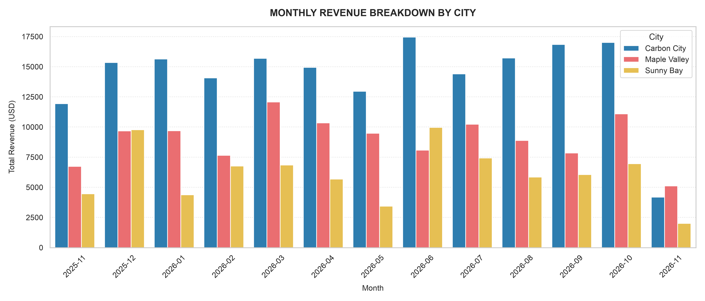
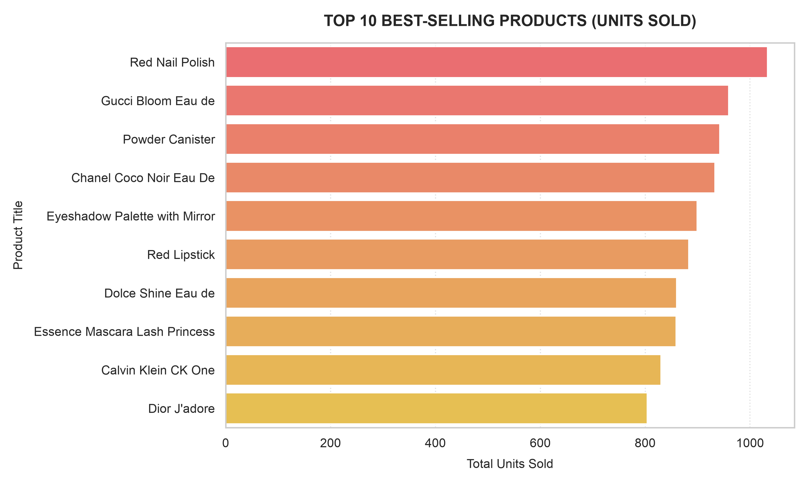
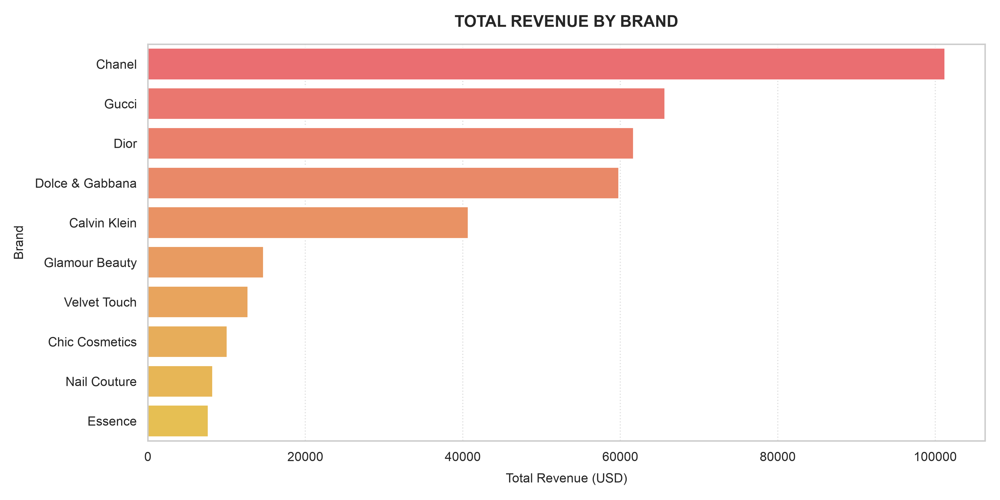

<small>This repository is protected under the **CC BY-NC 4.0** license.<small>

## Project overview
An end-to-end data pipeline case study combining live REST API ingestion with programmatic data simulation. This project extracts product catalog data from the DummyJSON REST API, synthesizes realistic e-commerce transactions using Python (Faker and random), normalizes the output into structured, linkable CSV datasets, and generates an automated visualization suite.

## Tech stack
* **Language:** Python
* **Data processing:** pandas
* **Data simulation:** Faker, random
* **Data visualization:** Matplotlib, Seaborn
* **API ingestion:** requests (DummyJSON REST API)

## Analysis

### Monthly revenue by city

* Carbon City consistently drives the highest monthly revenue volume throughout the entire timeline, frequently peaking around 15,000-17,500 USD per month

* Maple Valley secures a stable second place, experiencing notable performance peaks in March 2026 and October 2026

* Sunny Bay maintains a consistent baseline contribution but exhibits sharper cyclical fluctuations and lower overall revenue yields compared to the other two markets

### Top 10 products by revenue

* Red Nail Polish leads total unit sales comfortably past the 1,000-unit threshold, closely followed by Gucci Bloom Eau de and Powder Canister

* Top 5 items (led by cosmetics and fragrances) show a tight clustering between 880 and 1,000+ units sold, indicating strong consumer preference for beauty and personal care items

* Even the last ranking item (Dior J'adore) maintains a solid baseline of roughly 800 units sold, indicating well-distributed catalog demand

### Total revenue by brand

* Chanel dominates total financial yield, generating over 100,000 USD and significantly outpacing competitors, Gucci and Dior form a strong secondary revenue cluster in the 60,000-66,000 USD range
* Brands like Calvin Klein pull in around 40,000 USD, while beauty and specialty brands (Glamour Beauty, Essence) cluster at the lower end of the top 10 revenue spectrum (7,000-15,000 USD)

* Comparing this chart with the product sales chart highlights how higher-end luxury brands generate massive revenue impact even if individual unit sales volumes are balanced across categories
