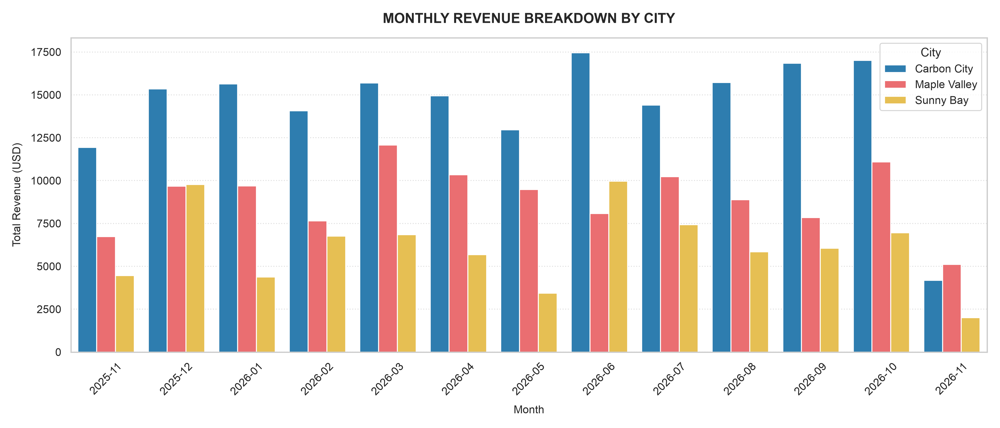
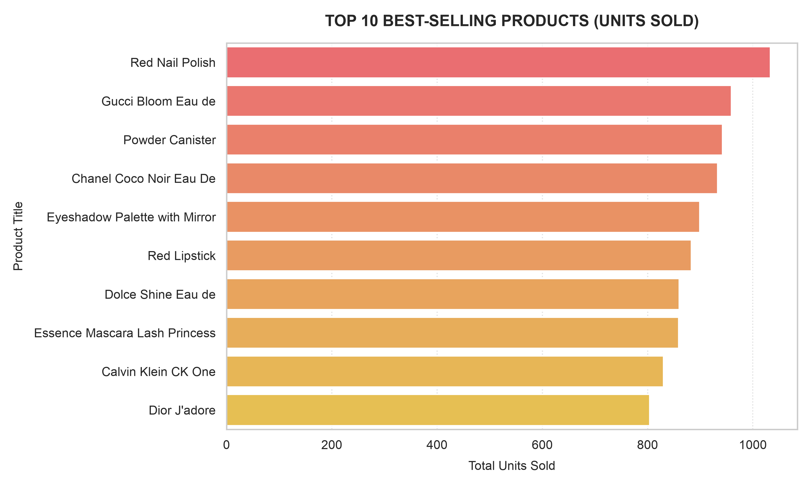
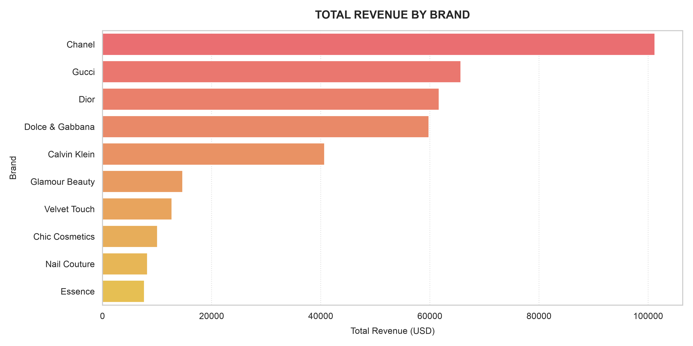

<small>Этот репозиторий защищён лицензией **CC BY-NC 4.0**.<small>

> <small><b>Язык:</b> Русский | <a href="README.md">Read in English</a></small>

## Обзор проекта
Пример реализации комплексного конвейера обработки данных, сочетающего получение информации через REST API с программной симуляцией данных. В рамках проекта из REST API (DummyJSON) извлекаются данные о каталоге товаров, с помощью Python (библиотеки Faker и random) генерируются реалистичные транзакционные данные, полученные данные приводятся к структурированному виду в формате CSV, и также создаются визуализации.

## Технический стек
* **Язык программирования:** Python
* **Обработка данных:** pandas
* **Симуляция данных:** Faker, random
* **Визуализация данных:** Matplotlib, Seaborn
* **Загрузка данных через API:** requests (DummyJSON REST API)

## Анализ

### Ежемесячная выручка по городам

* Carbon City на протяжении всего рассматриваемого периода неизменно демонстрирует самый высокий объём ежемесячной выручки, зачастую достигая пиковых значений в диапазоне 15,000–17,500 долларов США в месяц
* Maple Valley уверенно занимает второе место, при этом в марте и октябре 2026 года были зафиксированы заметные всплески показателей
* Sunny Bay обеспечивает стабильный базовый уровень поступлений, однако для этого рынка характерны более выраженные циклические колебания и в целом более низкие показатели выручки по сравнению с двумя другими рынками

### Топ 10 продуктов по выручке

* Лидером по общему объёму продаж в штучном выражении стал красный лак для ногтей — его показатели уверенно превысили отметку в 1000 единиц; следом за ним идут парфюмерная вода Gucci Bloom и пудра в футляре
* Пять самых продаваемых товаров (в основном — косметика и парфюмерия) демонстрируют схожие результаты: от 880 до более чем 1000 проданных единиц, что свидетельствует о высоком потребительском спросе на товары для красоты и личного ухода
* Даже товар, замыкающий рейтинг (аромат Dior J'adore), показывает уверенный результат — около 800 проданных единиц, что говорит о равномерном спросе на весь представленный ассортимент

### Общая выручка по брендам

* Chanel лидирует по общему объёму финансовой выручки, генерируя более 100,000 долларов США и значительно опережая конкурентов; Gucci и Dior формируют вторую группу по уровню доходов — в диапазоне 60,000–66,000 долларов США
* Такие бренды, как Calvin Klein, приносят около 40 000 долларов США, в то время как бренды из сегментов косметики и специализированных товаров (например, Glamour Beauty, Essence) располагаются в нижней части топ-10 по объему выручки (7,000–15,000 долларов США)
* Сопоставление этого графика с данными о продажах отдельных товаров наглядно показывает, что люксовые бренды высокого уровня обеспечивают значительно более высокую выручку, даже если объёмы продаж в штучном выражении сопоставимы по разным категориям
